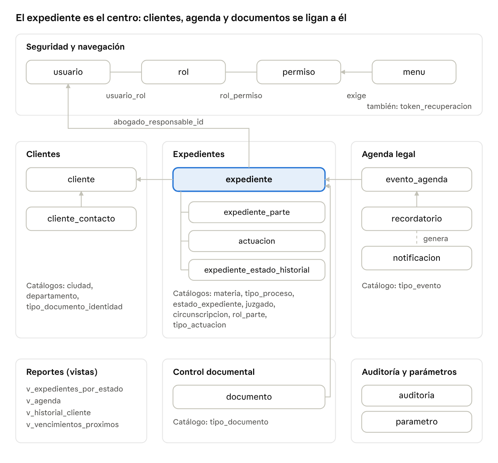

# Modelo de datos — Sistema de Gestión de Casos Jurídicos

Versión del 2026-11-17. Copia del documento de diseño; esta copia en el repositorio es la que se mantiene al día.

## Alcance

El modelo cubre los cinco módulos funcionales del sistema con 31 tablas en SQL Server, más la base de seguridad (usuarios, roles, permisos y menús) que los sostiene. El asistente legal con IA queda fuera de esta versión y se describe como sugerencia al final.

| Requerimiento | Módulo | Tablas que lo cubren |
| --- | --- | --- |
| Ingreso al sistema, perfiles y menú según el perfil | Seguridad | `usuario`, `rol`, `usuario_rol`, `permiso`, `rol_permiso`, `menu`, `token_recuperacion` |
| Alta de clientes | Clientes | `cliente`, `cliente_contacto` |
| Consulta del historial de casos | Clientes | `expediente` filtrado por `cliente_id` (vista `v_historial_cliente`) |
| Registro de nuevos casos | Expedientes | `expediente`, `expediente_parte`, `actuacion`, `expediente_estado_historial` |
| Calendario de audiencias | Agenda | `evento_agenda`, `tipo_evento` |
| Aviso por vencimientos | Agenda | `evento_agenda` (plazos), `recordatorio`, `notificacion` |
| Adjuntar archivos por expediente | Documentos | `documento`, `tipo_documento` |
| Buscador por nombre, tipo o fecha | Documentos | Índices sobre `documento` (nombre, tipo, fecha) |
| Casos activos vs cerrados | Reportes | Vista `v_expedientes_por_estado` |
| Agenda semanal y mensual | Reportes | Vista `v_agenda` |
| Asistente legal con IA | Sugerencia futura | Fuera de esta versión |

El sistema lo usa un estudio de un abogado con su equipo (asistentes o pasantes); los clientes no ingresan al sistema en esta versión.

## Convenciones del modelo

Todas las tablas siguen las mismas reglas, así el código de acceso a datos es uniforme.

| Tema | Regla |
| --- | --- |
| Motor | SQL Server 2019 o superior (desarrollo: SQL Server 2022 Developer local), base `EstudioJuridico`, esquema `dbo` |
| Intercalación | `Modern_Spanish_CI_AI` en la base: las búsquedas y las claves únicas no distinguen mayúsculas ni acentos (la Ñ sigue siendo una letra distinta de la N) |
| Versionado del esquema | Flyway, con scripts numerados en `src/main/resources/db/migration` (`V1__seguridad.sql`, `V2__catalogos.sql`…). Una vista por lote, separadas con `GO` |
| Nombres | Español, `snake_case`, tablas en singular (`cliente`, `expediente`). Restricciones con prefijo: `pk_`, `fk_`, `uq_`, `ck_`, `df_`, `ix_` |
| Clave primaria | `id BIGINT IDENTITY(1,1)` en todas las tablas, salvo las tablas puente (clave compuesta) |
| Claves foráneas | `<tabla>_id`, con índice propio. Sin borrado en cascada (`NO ACTION`, equivalente a `RESTRICT`) |
| Códigos de catálogo | `codigo VARCHAR(30) UNIQUE` en mayúsculas (`CIVIL`, `AUDIENCIA`), usados por el código en lugar del `id` |
| Campos de auditoría | En las tablas de negocio: `creado_en`, `creado_por`, `modificado_en`, `modificado_por` (`DATETIMEOFFSET` y `BIGINT` hacia `usuario`) |
| Borrado | Lógico, con `activo BIT DEFAULT 1` en catálogos, clientes y usuarios, y `eliminado_en DATETIMEOFFSET` en documentos. Los expedientes no se borran: se cierran |
| Fechas y horas | `DATE` para fechas sin hora; `DATETIMEOFFSET(3)` para momentos, guardados en UTC y mostrados en hora de Paraguay (`America/Asuncion` en Java, `Paraguay Standard Time` en SQL Server) |
| Lógicos | `BIT` (`1` verdadero, `0` falso) |
| Importes | `NUMERIC(15,2)` con `moneda CHAR(3)` (`PYG`, `USD`) |
| Textos | `NVARCHAR(n)` para lo que escribe el usuario (nombres, direcciones, descripciones), así se guardan bien tildes y eñes; `VARCHAR(n)` para códigos, teléfonos y otros valores ASCII; `NVARCHAR(MAX)` para descripciones y observaciones |
| JSON | `NVARCHAR(MAX)` con una restricción `ISJSON(...) = 1` |
| Únicos con nulos | Índice único filtrado (`WHERE columna IS NOT NULL`), porque en SQL Server una restricción `UNIQUE` admite un solo nulo |
| Archivos | En disco o en un almacenamiento de objetos, nunca dentro de la base. La base guarda la ruta, el tipo y el hash |
| Contraseñas | Solo el hash (BCrypt), nunca la contraseña |
| Credenciales de conexión | Variables de entorno (`DB_URL`, `DB_USER`, `DB_PASSWORD`), nunca en el repositorio |

En las tablas de las secciones siguientes se omiten `id` y los campos de auditoría para abreviar: se dan por incluidos donde la regla lo indica.

## Seguridad y navegación

Un usuario tiene uno o más roles, cada rol agrupa permisos, y cada opción del menú exige un permiso: el menú lateral muestra solo las opciones que los roles del usuario habilitan. El menú tiene tres niveles, igual que el layout de la plantilla: módulo, sección y opción.

### usuario

| Campo | Tipo | Regla |
| --- | --- | --- |
| `nombre_usuario` | VARCHAR(30) | Único, en minúsculas. Con él se ingresa |
| `email` | VARCHAR(120) | Único. Para avisos y recuperación de contraseña |
| `clave_hash` | VARCHAR(100) | Hash BCrypt |
| `nombres`, `apellidos` | VARCHAR(80) | Obligatorios |
| `telefono` | VARCHAR(30) | Opcional |
| `matricula` | VARCHAR(30) | Matrícula profesional, solo para abogados |
| `debe_cambiar_clave` | BIT | `1` al crear el usuario o al reiniciar su clave |
| `intentos_fallidos` | SMALLINT | Se bloquea al llegar al límite (parámetro `seguridad.max_intentos`) |
| `bloqueado_hasta` | DATETIMEOFFSET | Nulo si no está bloqueado |
| `ultimo_acceso` | DATETIMEOFFSET | Fecha del último ingreso correcto |
| `activo` | BIT | Un usuario inactivo no puede ingresar |

### rol

| Campo | Tipo | Regla |
| --- | --- | --- |
| `codigo` | VARCHAR(30) | Único (`ADMINISTRADOR`, `ABOGADO`, `ASISTENTE`) |
| `nombre` | VARCHAR(60) | Nombre visible |
| `descripcion` | NVARCHAR(MAX) | Opcional |
| `activo` | BIT | |

### usuario_rol

Tabla puente con clave `(usuario_id, rol_id)`. Un usuario puede tener varios roles.

### permiso

| Campo | Tipo | Regla |
| --- | --- | --- |
| `codigo` | VARCHAR(50) | Único, con la forma `MÓDULO_ACCIÓN` (`CLIENTES_VER`, `CLIENTES_EDITAR`, `EXPEDIENTES_CERRAR`) |
| `modulo` | VARCHAR(30) | Para agrupar en la pantalla de roles (`CLIENTES`, `EXPEDIENTES`…) |
| `descripcion` | VARCHAR(150) | Qué habilita |

Los permisos los define el sistema (datos iniciales), no el usuario: cada uno corresponde a un control en el código.

### rol_permiso

Tabla puente con clave `(rol_id, permiso_id)`.

### menu

| Campo | Tipo | Regla |
| --- | --- | --- |
| `padre_id` | BIGINT | Nulo en un módulo; apunta al módulo en una sección y a la sección en una opción |
| `nivel` | VARCHAR(10) | `MODULO`, `SECCION` u `OPCION` |
| `codigo` | VARCHAR(40) | Único (`CLIENTES`, `CLIENTES_LISTA`) |
| `titulo` | VARCHAR(60) | Texto del menú |
| `icono` | VARCHAR(40) | Id del ícono del sprite sin `i-` (solo en módulos) |
| `ruta` | VARCHAR(120) | Solo en opciones (`/clientes`) |
| `permiso_id` | BIGINT | Permiso que exige la opción. Un módulo o una sección se muestran si tienen al menos una opción visible |
| `orden` | SMALLINT | Orden dentro de su padre |
| `activo` | BIT | |

### token_recuperacion

| Campo | Tipo | Regla |
| --- | --- | --- |
| `usuario_id` | BIGINT | Usuario que pidió recuperar la clave |
| `token_hash` | VARCHAR(100) | Hash del enlace enviado por email, nunca el token |
| `vence_en` | DATETIMEOFFSET | 30 minutos después de creado |
| `usado_en` | DATETIMEOFFSET | Nulo hasta que se usa; un token se usa una sola vez |

Las sesiones las maneja Spring Security en memoria: no hace falta una tabla. Los ingresos y los intentos fallidos quedan en `auditoria`.

## Gestión de clientes

Un cliente puede ser una persona física o una empresa. Una empresa puede tener varias personas de contacto. El historial de casos no necesita tabla propia: se arma con los expedientes del cliente.

### cliente

| Campo | Tipo | Regla |
| --- | --- | --- |
| `tipo_persona` | CHAR(1) | `F` (física) o `J` (jurídica) |
| `nombres`, `apellidos` | VARCHAR(80) | Obligatorios si es persona física |
| `razon_social` | VARCHAR(150) | Obligatoria si es persona jurídica |
| `tipo_documento_identidad_id` | BIGINT | Cédula, RUC, pasaporte |
| `numero_documento` | VARCHAR(20) | Único junto con el tipo de documento |
| `fecha_nacimiento` | DATE | Opcional, solo persona física |
| `email` | VARCHAR(120) | Opcional |
| `telefono`, `celular` | VARCHAR(30) | Al menos uno obligatorio |
| `direccion` | VARCHAR(200) | Opcional |
| `ciudad_id` | BIGINT | Opcional, catálogo de ciudades de Paraguay |
| `observaciones` | NVARCHAR(MAX) | Notas internas del estudio |
| `activo` | BIT | Un cliente inactivo no aparece al registrar casos nuevos, pero conserva su historial |

### cliente_contacto

| Campo | Tipo | Regla |
| --- | --- | --- |
| `cliente_id` | BIGINT | Cliente al que pertenece |
| `nombre` | VARCHAR(120) | Obligatorio |
| `cargo` | VARCHAR(60) | Por ejemplo, gerente o apoderado |
| `email` | VARCHAR(120) | Opcional |
| `telefono` | VARCHAR(30) | Opcional |
| `es_principal` | BIT | Un solo contacto principal por cliente |

### Historial de casos

La vista `v_historial_cliente` lista, para un cliente, sus expedientes con número, carátula, materia, estado, fecha de inicio, fecha de cierre y la próxima fecha de agenda. Cubre los expedientes donde figura como cliente principal; si más adelante un caso puede tener varios clientes, se agrega la tabla puente `expediente_cliente` sin cambiar el resto.

## Gestión de expedientes

El expediente es la tabla central: une al cliente, al abogado responsable, al juzgado, a las partes, a la agenda y a los documentos. Su estado decide si cuenta como caso activo o cerrado en los reportes.

### expediente

| Campo | Tipo | Regla |
| --- | --- | --- |
| `numero_interno` | VARCHAR(20) | Único, lo genera el sistema (`2026-0001`) |
| `caratula` | VARCHAR(250) | Por ejemplo, “Pérez, Juan c/ Gómez, Ana s/ cobro de guaraníes” |
| `cliente_id` | BIGINT | Cliente principal |
| `abogado_responsable_id` | BIGINT | Usuario con rol `ABOGADO` |
| `materia_id` | BIGINT | Civil, Penal, Laboral, Familia… |
| `tipo_proceso_id` | BIGINT | Debe pertenecer a la materia elegida |
| `juzgado_id` | BIGINT | Opcional mientras el caso no está judicializado |
| `numero_expediente_judicial` | VARCHAR(40) | Número que asigna el juzgado, opcional |
| `anio_judicial` | SMALLINT | Año del número judicial |
| `estado_expediente_id` | BIGINT | Estado actual |
| `fecha_inicio` | DATE | Obligatoria |
| `fecha_cierre` | DATE | Obligatoria al pasar a un estado de cierre |
| `motivo_cierre` | NVARCHAR(MAX) | Obligatorio al cerrar (sentencia, acuerdo, desistimiento…) |
| `descripcion` | NVARCHAR(MAX) | Resumen de los hechos y del objetivo |
| `monto_reclamado` | NUMERIC(15,2) | Opcional, con `moneda` |
| `moneda` | CHAR(3) | `PYG` por defecto |

### Catálogos del expediente

| Tabla | Campos | Ejemplos |
| --- | --- | --- |
| `materia` | `codigo`, `nombre`, `activo` | Civil, Comercial, Penal, Laboral, Familia, Niñez y Adolescencia, Contencioso-Administrativo |
| `tipo_proceso` | `materia_id`, `codigo`, `nombre`, `activo` | Civil: ordinario, ejecutivo, sucesión. Penal: acción penal pública, acción penal privada |
| `estado_expediente` | `codigo`, `nombre`, `es_activo`, `es_cierre`, `orden` | Abierto, En trámite, Suspendido, Con sentencia, Cerrado, Archivado |
| `circunscripcion` | `codigo`, `nombre` | Capital, Central, Alto Paraná |
| `juzgado` | `circunscripcion_id`, `materia_id`, `nombre`, `turno`, `direccion`, `telefono`, `activo` | Juzgado de Primera Instancia en lo Civil y Comercial, 3.er Turno |
| `rol_parte` | `codigo`, `nombre` | Actor, Demandado, Tercero, Querellante, Imputado, Víctima |
| `tipo_actuacion` | `codigo`, `nombre` | Presentación de escrito, Notificación recibida, Providencia, Reunión con el cliente, Nota interna |

`es_activo` define qué estados cuentan como casos activos en los reportes, y `es_cierre` cuáles exigen fecha y motivo de cierre.

### expediente_parte

Las otras personas del caso (contraparte, terceros). No son clientes del estudio, por eso van aparte.

| Campo | Tipo | Regla |
| --- | --- | --- |
| `expediente_id` | BIGINT | |
| `rol_parte_id` | BIGINT | Qué papel cumple en el caso |
| `nombre` | VARCHAR(150) | Persona o empresa |
| `numero_documento` | VARCHAR(20) | Opcional |
| `abogado` | VARCHAR(120) | Abogado de esa parte, opcional |
| `contacto` | VARCHAR(150) | Teléfono o email, opcional |
| `observaciones` | NVARCHAR(MAX) | Opcional |

### actuacion

La bitácora del expediente: cada movimiento en orden de fecha.

| Campo | Tipo | Regla |
| --- | --- | --- |
| `expediente_id` | BIGINT | |
| `tipo_actuacion_id` | BIGINT | |
| `fecha` | DATE | Fecha del movimiento, puede ser anterior a la carga |
| `descripcion` | NVARCHAR(MAX) | Obligatoria |
| `usuario_id` | BIGINT | Quien la registró |

### expediente_estado_historial

| Campo | Tipo | Regla |
| --- | --- | --- |
| `expediente_id` | BIGINT | |
| `estado_anterior_id` | BIGINT | Nulo en el primer registro |
| `estado_nuevo_id` | BIGINT | |
| `fecha` | DATETIMEOFFSET | Momento del cambio |
| `usuario_id` | BIGINT | Quien lo cambió |
| `observacion` | NVARCHAR(MAX) | Motivo del cambio |

Cada cambio de estado del expediente inserta una fila aquí, en la misma transacción.

## Agenda legal

Audiencias, plazos procesales, reuniones y diligencias son eventos de una misma tabla, distinguidos por su tipo; así el calendario los muestra juntos. Los avisos por vencimiento salen de recordatorios programados que una tarea del sistema revisa cada pocos minutos y convierte en notificaciones.

### tipo_evento

| Campo | Tipo | Regla |
| --- | --- | --- |
| `codigo` | VARCHAR(30) | `AUDIENCIA`, `VENCIMIENTO`, `REUNION`, `DILIGENCIA` |
| `nombre` | VARCHAR(60) | |
| `color` | VARCHAR(20) | Token de color para el calendario |
| `es_plazo` | BIT | `1` para vencimientos: no tienen hora de fin y generan avisos por defecto |
| `aviso_dias_defecto` | SMALLINT | Días de anticipación del primer aviso (por ejemplo, 3) |

### evento_agenda

| Campo | Tipo | Regla |
| --- | --- | --- |
| `tipo_evento_id` | BIGINT | |
| `expediente_id` | BIGINT | Opcional: una reunión puede no tener caso |
| `titulo` | VARCHAR(150) | Por ejemplo, “Audiencia de conciliación” o “Vence plazo para contestar demanda” |
| `descripcion` | NVARCHAR(MAX) | Opcional |
| `fecha_inicio` | DATETIMEOFFSET | Para un vencimiento, el día y la hora límite |
| `fecha_fin` | DATETIMEOFFSET | Nula en vencimientos |
| `todo_el_dia` | BIT | |
| `lugar` | VARCHAR(200) | Opcional |
| `juzgado_id` | BIGINT | Opcional, para audiencias |
| `responsable_id` | BIGINT | Usuario a cargo |
| `estado` | VARCHAR(15) | `PENDIENTE`, `REALIZADO`, `SUSPENDIDO`, `CANCELADO` |
| `resultado` | NVARCHAR(MAX) | Qué pasó, al marcarlo realizado |

### recordatorio

| Campo | Tipo | Regla |
| --- | --- | --- |
| `evento_agenda_id` | BIGINT | |
| `usuario_id` | BIGINT | A quién avisar |
| `fecha_aviso` | DATETIMEOFFSET | Cuándo avisar; se calcula al guardar el evento |
| `canal` | VARCHAR(10) | `SISTEMA` (campana del sistema) o `EMAIL` |
| `estado` | VARCHAR(10) | `PENDIENTE`, `ENVIADO`, `ERROR`, `ANULADO` |
| `enviado_en` | DATETIMEOFFSET | |

Al crear un vencimiento se generan, por defecto, avisos a 3 días, 1 día y el mismo día (parámetro `agenda.dias_aviso`). Si el evento cambia de fecha, los recordatorios pendientes se recalculan; si se cancela, se anulan.

### notificacion

| Campo | Tipo | Regla |
| --- | --- | --- |
| `usuario_id` | BIGINT | Destinatario |
| `titulo` | VARCHAR(150) | |
| `mensaje` | NVARCHAR(MAX) | |
| `tipo` | VARCHAR(20) | `VENCIMIENTO`, `AUDIENCIA`, `SISTEMA` |
| `referencia_tipo`, `referencia_id` | VARCHAR(30), BIGINT | Qué abrir al hacer clic (por ejemplo, `EXPEDIENTE` y su id) |
| `leida_en` | DATETIMEOFFSET | Nula mientras no se lee |

Además de los recordatorios, la pantalla de inicio puede listar los vencimientos de los próximos 7 días directamente desde `evento_agenda`.

## Control documental

Cada archivo adjunto es una fila de `documento` ligada a un expediente; el archivo vive fuera de la base, en una carpeta por expediente. El buscador filtra por nombre, tipo y fecha sobre índices de esta tabla.

### tipo_documento

| Campo | Tipo | Ejemplos |
| --- | --- | --- |
| `codigo`, `nombre`, `activo` | VARCHAR(30), NVARCHAR(60), BIT | Escrito, Resolución judicial, Notificación, Prueba, Contrato, Poder, Cédula de identidad, Otro |

### documento

| Campo | Tipo | Regla |
| --- | --- | --- |
| `expediente_id` | BIGINT | Obligatorio |
| `tipo_documento_id` | BIGINT | Obligatorio |
| `nombre` | VARCHAR(200) | Título visible, editable (por defecto, el nombre del archivo) |
| `descripcion` | NVARCHAR(MAX) | Opcional |
| `fecha_documento` | DATE | Fecha del documento en sí (de la resolución, del escrito), no la de carga |
| `nombre_archivo` | VARCHAR(255) | Nombre original del archivo |
| `ruta_almacenamiento` | VARCHAR(500) | Ruta relativa: `expedientes/<id>/<uuid>.<extensión>` |
| `tipo_mime` | VARCHAR(100) | `application/pdf`, `image/jpeg`… |
| `tamano_bytes` | BIGINT | Límite por parámetro `documentos.tamano_max_mb` |
| `hash_sha256` | CHAR(64) | Detecta archivos duplicados y alteraciones |
| `actuacion_id` | BIGINT | Opcional: la actuación con la que llegó el documento |
| `eliminado_en` | DATETIMEOFFSET | Borrado lógico; el archivo se conserva |

### Buscador

| Filtro | Cómo se resuelve |
| --- | --- |
| Nombre | `nombre LIKE '%texto%'`, sin distinguir mayúsculas ni acentos gracias a la intercalación de la base; índice sobre `nombre` |
| Tipo | Índice sobre `tipo_documento_id` |
| Fecha | Índice sobre `fecha_documento`, con rango desde–hasta |
| Expediente o cliente | Índice sobre `expediente_id`; el cliente, a través del expediente |

La búsqueda dentro del contenido de los PDF (texto completo) queda para más adelante: encaja con el módulo de IA. Si la tabla crece mucho, la búsqueda por nombre puede pasar a la búsqueda de texto completo de SQL Server (`CONTAINS`).

## Reportes

Los reportes no guardan datos propios: son vistas sobre las tablas anteriores, con filtros que elige el usuario en pantalla. Las vistas devuelven una fila por expediente o por evento; los filtros y los totales (`COUNT … GROUP BY`) los aplica la consulta de la aplicación, porque una vista ya agrupada no se podría filtrar por fecha.

| Vista | Qué devuelve | Filtros en pantalla |
| --- | --- | --- |
| `v_expedientes_por_estado` | Cada expediente con su estado, su agrupación activo/cerrado (`situacion`, según `estado_expediente.es_activo`), su materia y su abogado, para contarlos por esos grupos | Rango de fecha de inicio, materia, abogado responsable |
| `v_agenda` | Eventos con fecha, hora (también en hora local de Paraguay), tipo y color, título, expediente, carátula, juzgado, responsable y estado | Semana o mes, tipo de evento, responsable, estado |
| `v_historial_cliente` | Expedientes de cada cliente con estado y próxima fecha de agenda (ver Gestión de clientes) | Cliente |
| `v_vencimientos_proximos` | Plazos pendientes con `dias_restantes` (negativo si ya venció) | Días (7 por defecto), responsable |

La semana va de lunes a domingo. Los reportes se ven en pantalla y se exportan a PDF y Excel desde la aplicación.

## Auditoría, parámetros y catálogos generales

### auditoria

Registra quién hizo qué y cuándo: ingresos, intentos fallidos y cada alta, modificación o baja en las tablas de negocio. No se modifica ni se borra desde la aplicación.

| Campo | Tipo | Regla |
| --- | --- | --- |
| `fecha` | DATETIMEOFFSET | |
| `usuario_id` | BIGINT | Nulo en un intento de ingreso con usuario inexistente |
| `accion` | VARCHAR(20) | `INGRESO`, `INGRESO_FALLIDO`, `SALIDA`, `ALTA`, `MODIFICACION`, `BAJA`, `DESCARGA` |
| `tabla` | VARCHAR(50) | Tabla afectada |
| `registro_id` | BIGINT | Fila afectada |
| `datos_anteriores`, `datos_nuevos` | NVARCHAR(MAX) con JSON | Valores antes y después del cambio |
| `ip` | VARCHAR(45) | Dirección de origen |

### parametro

Valores que cambian el comportamiento sin tocar el código.

| `clave` | Valor inicial | Uso |
| --- | --- | --- |
| `seguridad.max_intentos` | 5 | Intentos fallidos antes de bloquear al usuario |
| `seguridad.minutos_bloqueo` | 15 | Duración del bloqueo |
| `agenda.dias_aviso` | 3,1,0 | Días antes del vencimiento en que se avisa |
| `documentos.tamano_max_mb` | 20 | Tamaño máximo por archivo |
| `documentos.tipos_permitidos` | pdf,doc,docx,jpg,png | Extensiones aceptadas |
| `expediente.formato_numero` | AAAA-NNNN | Formato del número interno |

Campos: `clave` (única), `valor`, `tipo` (`NUMERO`, `TEXTO`, `LISTA`, `BOOLEANO`), `descripcion`.

### Catálogos generales

| Tabla | Campos | Contenido inicial |
| --- | --- | --- |
| `departamento` | `codigo`, `nombre` | Los 17 departamentos de Paraguay y Asunción |
| `ciudad` | `departamento_id`, `nombre` | Capitales departamentales y ciudades principales; el resto de los distritos se agrega cuando haga falta |
| `tipo_documento_identidad` | `codigo`, `nombre` | Cédula de identidad, RUC, Pasaporte |

## Diagrama entidad-relación

Las flechas van de la tabla que guarda la clave foránea a la tabla referenciada; las líneas sin flecha entre usuario, rol y permiso son relaciones de muchos a muchos a través de sus tablas puente. Las tablas hijas del expediente y los catálogos también referencian a su tabla principal, y casi todas las tablas de negocio apuntan a `usuario` por los campos de auditoría (no se dibujan para no saturar el diagrama).

## Datos iniciales

La primera migración (`V1__seguridad.sql`) crea tres roles, los permisos de cada módulo y el menú completo; la segunda (`V2__catalogos.sql`), los catálogos y los parámetros. El usuario administrador no va en las migraciones, porque su clave no puede quedar en un repositorio público: lo crea la aplicación en el paso de seguridad, con una clave inicial tomada de una variable de entorno y `debe_cambiar_clave = 1`.

### Roles y permisos

| Permiso | Administrador | Abogado | Asistente |
| --- | --- | --- | --- |
| `CLIENTES_VER` | Sí | Sí | Sí |
| `CLIENTES_EDITAR` | Sí | Sí | Sí |
| `EXPEDIENTES_VER` | Sí | Sí | Sí |
| `EXPEDIENTES_EDITAR` | Sí | Sí | Sí |
| `EXPEDIENTES_CERRAR` | Sí | Sí | No |
| `AGENDA_VER` | Sí | Sí | Sí |
| `AGENDA_EDITAR` | Sí | Sí | Sí |
| `DOCUMENTOS_VER` | Sí | Sí | Sí |
| `DOCUMENTOS_SUBIR` | Sí | Sí | Sí |
| `DOCUMENTOS_ELIMINAR` | Sí | Sí | No |
| `REPORTES_VER` | Sí | Sí | No |
| `CATALOGOS_EDITAR` | Sí | No | No |
| `SEGURIDAD_ADMINISTRAR` | Sí | No | No |
| `AUDITORIA_VER` | Sí | No | No |

### Menú

| Módulo (ícono) | Sección | Opción | Ruta | Permiso |
| --- | --- | --- | --- | --- |
| Clientes (`users`) | — | Clientes | `/clientes` | `CLIENTES_VER` |
| Expedientes (`archive`) | — | Expedientes | `/expedientes` | `EXPEDIENTES_VER` |
| Expedientes (`archive`) | — | Nuevo expediente | `/expedientes/nuevo` | `EXPEDIENTES_EDITAR` |
| Agenda (`calendar-check`) | — | Calendario | `/agenda` | `AGENDA_VER` |
| Agenda (`calendar-check`) | — | Vencimientos | `/agenda/vencimientos` | `AGENDA_VER` |
| Documentos (`file-text`) | — | Buscar documentos | `/documentos` | `DOCUMENTOS_VER` |
| Reportes (`bar-chart3`) | — | Casos activos y cerrados | `/reportes/expedientes` | `REPORTES_VER` |
| Reportes (`bar-chart3`) | — | Agenda semanal y mensual | `/reportes/agenda` | `REPORTES_VER` |
| Administración (`settings`) | Seguridad | Usuarios | `/admin/usuarios` | `SEGURIDAD_ADMINISTRAR` |
| Administración (`settings`) | Seguridad | Roles y permisos | `/admin/roles` | `SEGURIDAD_ADMINISTRAR` |
| Administración (`settings`) | Seguridad | Auditoría | `/admin/auditoria` | `AUDITORIA_VER` |
| Administración (`settings`) | Catálogos | Materias y tipos de proceso | `/admin/materias` | `CATALOGOS_EDITAR` |
| Administración (`settings`) | Catálogos | Juzgados | `/admin/juzgados` | `CATALOGOS_EDITAR` |
| Administración (`settings`) | Catálogos | Estados del expediente | `/admin/estados` | `CATALOGOS_EDITAR` |
| Administración (`settings`) | Catálogos | Tipos de documento y de evento | `/admin/tipos` | `CATALOGOS_EDITAR` |
| Administración (`settings`) | Configuración | Parámetros | `/admin/parametros` | `SEGURIDAD_ADMINISTRAR` |

Todos los íconos ya existen en el sprite de la plantilla. La pantalla de un expediente reúne en pestañas sus partes, actuaciones, agenda y documentos, así que esas opciones no van en el menú.

También se cargan los catálogos: materias, tipos de proceso, estados, roles de parte, tipos de actuación, tipos de evento, tipos de documento, departamentos, ciudades y tipos de documento de identidad.

## Sugerencia a futuro: asistente legal con IA

Este módulo queda para la última etapa y no se crea ahora; el modelo de esta versión ya deja lugar para sumarlo sin cambiar las tablas existentes. Lo que sigue es una propuesta para discutir, no un diseño cerrado.

- **Enfoque sugerido:** en lugar de entrenar un modelo, cargar el texto de las leyes paraguayas por artículo y buscar los artículos más parecidos a la consulta (búsqueda semántica). Un modelo de lenguaje redacta la respuesta citando esos artículos. Así cada sugerencia indica de qué ley y artículo sale, y actualizar una ley es volver a cargar su texto.
- **Fuentes iniciales:** Constitución Nacional, Código Civil, Código Penal, Código Procesal Civil, Código Procesal Penal y leyes especiales que el estudio elija.
- **Tablas tentativas:** `norma` (ley o código, número, fecha, fuente oficial), `articulo_norma` (número, texto y su representación para la búsqueda, guardada como vector; SQL Server 2025 trae el tipo `VECTOR`, y en versiones anteriores se usa un servicio de búsqueda aparte), `consulta_ia` (usuario, expediente opcional, pregunta, respuesta, fecha) y `consulta_ia_articulo` (artículos sugeridos en cada respuesta).
- **Otros usos posibles:** ayuda para redactar escritos a partir de los datos del expediente, y búsqueda dentro del contenido de los documentos adjuntos.
- **A definir en esa etapa:** qué proveedor de IA usar y su costo, de dónde se obtienen los textos oficiales actualizados, y cómo se cuida la confidencialidad de los datos del cliente que se envían en una consulta.

La respuesta de la IA es una ayuda para el abogado y siempre debe revisarse antes de usarse.

## Plan de implementación

Se construye por módulos, en el orden en que dependen unos de otros: cada paso crea su migración Flyway, sus pantallas sobre la plantilla y sus pruebas antes de pasar al siguiente.

1. **Base:** SQL Server, Flyway, JDBC (`NamedParameterJdbcTemplate`, SQL explícito; se descartó JPA por los `DATETIMEOFFSET`, las vistas y los filtros dinámicos), conexión por variables de entorno. *Hecho: las migraciones `V1` a `V7` crean las 31 tablas, las 4 vistas y los datos iniciales.*
2. **Seguridad:** usuarios, roles, permisos, menú desde la base, ingreso con la pantalla de login de la plantilla, recuperación de clave y auditoría de ingresos. *Hecho: ingreso, bloqueo por intentos, cambio de clave obligatorio, menú por permisos, auditoría de ingresos y ABM de usuarios. La recuperación de clave por email queda pendiente hasta definir el servidor de correo; mientras tanto, un administrador reinicia la clave. Roles y permisos se editan en la última etapa.*
3. **Catálogos y parámetros:** materias, tipos de proceso, estados, juzgados, tipos de evento y de documento, departamentos y ciudades. *Hecho: pantallas de catálogos (ABM genérico), parámetros, roles y auditoría.*
4. **Clientes:** alta, edición, contactos e historial de casos. *Hecho: lista con filtros, ABM, contactos (un solo principal) e historial desde la vista `v_historial_cliente`; la baja no se permite con casos activos.*
5. **Expedientes:** registro, partes, actuaciones, cambios de estado y cierre. *Hecho: número interno automático según `expediente.formato_numero` (correlativo por año, con bloqueo para altas simultáneas), partes, bitácora, historial de estados; cerrar y reabrir con `EXPEDIENTES_CERRAR`; un expediente cerrado es de solo lectura.*
6. **Agenda:** calendario, vencimientos, recordatorios y notificaciones. *Hecho: lista y calendario mensual, ABM de eventos con estados (pendiente, realizado, suspendido, cancelado) y recordatorios generados al guardar (se recalculan o anulan). Después: tarea programada que los convierte en notificaciones (solo en el sistema, sin email), campana con contador y pantalla de vencimientos.*
7. **Documentos:** carga de archivos por expediente y buscador.
8. **Reportes:** casos activos y cerrados, agenda semanal y mensual, exportación.
9. **Asistente con IA:** cuando el resto esté en uso.

Antes del paso 1 conviene confirmar:

- [x] Motor de base de datos: SQL Server, en desarrollo y al desplegar (decidido el 2026-11-17).
- [ ] ¿Dónde se guardan los archivos adjuntos: carpeta del servidor o almacenamiento en la nube?
- [ ] ¿Los avisos van solo dentro del sistema, o también por email (hace falta un servidor de correo)?
- [ ] ¿Un caso puede tener más de un cliente? (por ahora se supone uno solo)
